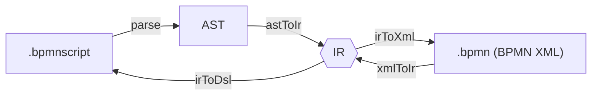

# BPMNscript

Write executable business processes as text, compile them to BPMN 2.0 XML, and read existing BPMN files back as text.

> Status: version 0.1.0 is the first release, from a bachelor's thesis project.
> Download the `.vsix` of the VS Code extension from the GitHub Release, or build everything from source as described below.
> The packages are not published to npm or the VS Code Marketplace.

## What it is

BPMN 2.0 is the standard for describing a business workflow as a diagram of tasks, gateways, and events.
A process engine such as [Operaton](https://operaton.org/) loads that diagram and runs it: it assigns the human steps to people, calls the automated ones, and waits on timers and incoming messages.
The diagram is stored as XML, and the XML is what gets deployed.

Usually you draw it in a graphical modeler.
BPMNscript gives BPMN a textual form instead:

```bpmnscript
process invoice-approval {
  start ReviewStart {
    form {
      amount: number "Invoice amount"
    }
  }
  user ReviewInvoice(assignee: "demo")
  if (amount > 1000) {
    user SeniorApproval(assignee: "manager")
  } else {
    service AutoApprove(class: "com.example.invoice.AutoApproveDelegate")
  }
  end Done
}
```

Compiling this gives you a BPMN 2.0 file that a graphical modeler opens as a diagram and Operaton deploys.

## Who it's for

Developers who'd rather work in a text editor than on a diagram canvas, and who want processes to fit their existing code workflow: git and diffs, autocompletion, and compile-time error checking.

You don't need to know BPMN to read or write BPMNscript.
The keywords say what a step does rather than mirroring the BPMN element behind them.
The diagram is generated for you, so there are no lines to route and no layout to redo after a change.

## Installing

You'll need Node.js 22 or newer and npm 10.2.3 or newer.

```sh
git clone https://github.com/BPMNscript/bpmnscript.git
cd bpmnscript
npm install
npm run build
```

`npm run build` generates the parser from the grammar, compiles every package, and bundles the VS Code extension.
To check it worked, run `npm test`.
The suite includes end-to-end tests that boot an Operaton engine in Docker, so it needs a running Docker daemon; set `SKIP_DOCKER_TESTS=true` to skip them ([CONTRIBUTING.md](CONTRIBUTING.md#getting-started)).

## Using the CLI

After a build, run the `bpmns` command with `npx`:

```sh
# Compile .bpmnscript to BPMN 2.0 XML, next to the source file
npx bpmns build examples/spring-boot/processes/invoice-approval.bpmnscript

# Choose the output path
cd examples/spring-boot/processes
npx bpmns build invoice-approval.bpmnscript -o out/invoice-approval.bpmn

# Decompile BPMN XML back to BPMNscript
npx bpmns parse out/invoice-approval.bpmn -o out/invoice-approval.bpmnscript
```

Warnings go to stderr and still produce a file.
A validation error on `build` or a BPMN construct the language can't express on `parse` exits `1` and writes nothing.
[packages/cli/README.md](packages/cli/README.md) has the exit codes and the rules for overwriting files.

## Using the VS Code extension

Press <kbd>F5</kbd> from the repo root.
VS Code opens a second window with the extension loaded, where `.bpmnscript` files get:

- syntax highlighting, including the fenced body of a `script` task in its own language (JavaScript, Groovy, Python and Ruby)
- completion, hover, go to definition, find all references, rename, and an outline
- errors and warnings inline as you type, from the same validator `bpmns build` runs
- a Convert panel in the sidebar that compiles the open file, opens its counterpart when one exists, or decompiles a `.bpmn` picked from disk

Compile and decompile are also in the command palette, under "BPMNscript".
To install the extension for everyday use, see [Installing](packages/extension/README.md#installing) in the extension README.

## The language

A file holds one `process` block.
Steps run top to bottom, so you never write a sequence flow; control flow uses structured statements (`if`, `while`, `parallel`, `goto`), and events read like try/catch with `on`, `throw` and `emit`.
The [language reference](packages/language/README.md) lists every statement, the BPMN element it compiles to, and the settings it takes.

[examples/spring-boot/processes/](examples/spring-boot/processes/) holds the example processes, each covering one construct or combination; [examples/README.md](examples/README.md) says which.

## Round-tripping BPMN XML to BPMNscript

BPMN is a much larger language than BPMNscript, so a `.bpmn` file can hold more than a script has a form for.
A decompile never changes a process without saying so ([ADR-0012](docs/decisions/0012-honest-bpmn-import.md)):

- A construct the language can't express, or one Operaton refuses to deploy, is refused with an error and nothing is written.
- Content BPMNscript doesn't carry, such as a lane, a pool or a text annotation, is dropped with a warning naming each item.
- A construct imported in a changed form gets a warning that says whether the engine runs it differently.
- A part of the graph the printer can't fit into a block becomes a `goto`, or a `// unstructured region: hand-repair required` comment where no jump fits, and is warned about.

Engine settings a modeler tunes on a step, such as async continuations, listeners, input/output parameters and forms, import without a warning.
The diagram's coordinates are discarded, since the layout is generated again on every compile.
[packages/transform/README.md](packages/transform/README.md#the-import-contract) lists every refusal and warning, and [docs/bpmn-coverage.md](docs/bpmn-coverage.md) shows what happens to each BPMN element.

## Running a process on a real engine

[examples/spring-boot/](examples/spring-boot/) is an Operaton 2.1.0 and Spring Boot deployment with Java delegates for the service tasks.
Its [README](examples/spring-boot/README.md) walks through compiling the processes, starting the engine, and stepping through a loan approval in Cockpit and Tasklist.

## Architecture

Both directions go through a shared intermediate representation (IR), so each transform converts to or from the IR and never directly between file formats.



The IR is a small set of plain TypeScript objects that describe one process in the engine's terms, tied to no file format ([ADR-0007](docs/decisions/0007-intermediate-representation-ast-bpmn.md)).
[packages/transform/README.md](packages/transform/README.md) describes it and the four transforms.

| Library                                                         | Role                                    |
| --------------------------------------------------------------- | --------------------------------------- |
| [Langium](https://langium.org/)                                 | Grammar, parser, AST, LSP server        |
| [bpmn-moddle](https://github.com/bpmn-io/bpmn-moddle)           | BPMN 2.0 XML reading and writing        |
| [bpmn-auto-layout](https://github.com/bpmn-io/bpmn-auto-layout) | Generates diagram layout data on export |

## Repository structure

```text
packages/
  language/      Langium grammar, AST, validator, language server
  transform/     IR types and the four transforms (AST/IR/XML/DSL)
  cli/           bpmns build / parse commands
  extension/     VS Code extension: language server, conversion commands, sidebar
tests/           Round-trip, fixture, and end-to-end tests
examples/
  spring-boot/   Operaton + Spring Boot deployment, also the e2e fixture
docs/
  decisions/        Architectural decision records
  bpmn-coverage.md  BPMN elements and what happens to each
  glossary.md       Shared vocabulary
```

## Limitations

- One executable process per file.
  A collaboration imports as its one executable process, with a warning per pool and per message flow, and a second executable process refuses the import.
- Lanes, data objects, data stores, text annotations and groups have no textual form and are dropped with a warning.
  Process variables are declared with `var` and reach a step through `input` and `output` parameters.
- An ad hoc sub-process and a complex gateway refuse the import.
- A standard loop is dropped with a warning, so the activity runs once.
- A compensation handler is written as an undo block inside a `subprocess`, so a compensation boundary event refuses the import and the message names the rewrite.
- A `decide` step names a deployed decision table; the table itself is written outside BPMNscript.
- Hand-placed diagram coordinates are discarded on import without a warning ([ADR-0009](docs/decisions/0009-auto-layout-and-expansion-hint.md)).

[docs/bpmn-coverage.md](docs/bpmn-coverage.md) has the full list.

## Project status

BPMNscript is being built as a bachelor's thesis at [University of Hamburg](https://www.uni-hamburg.de/), supervised by Dr. Oliver Kopp.
The thesis asks whether a textual DSL can be a practical alternative to graphical BPMN editors for developers who prefer working in code.

Design decisions are written up as [Markdown ADRs](docs/decisions/) using [MADR 4.0.0](https://adr.github.io/madr/), and terms are collected in the [glossary](docs/glossary.md).

## Contributing

See [CONTRIBUTING.md](CONTRIBUTING.md).

## License

[Apache-2.0](LICENSE)
